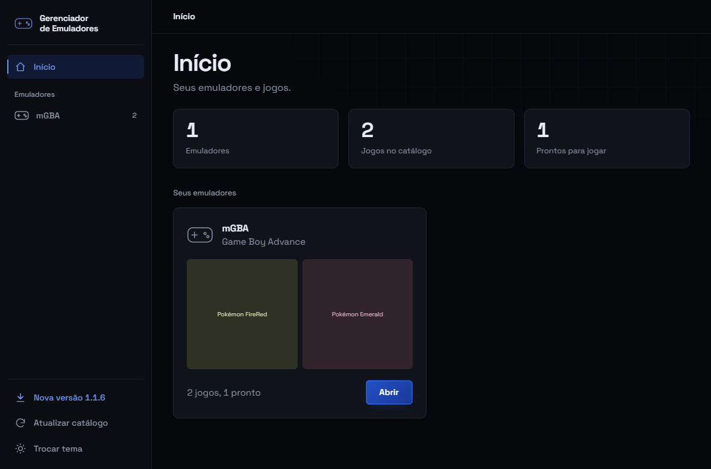
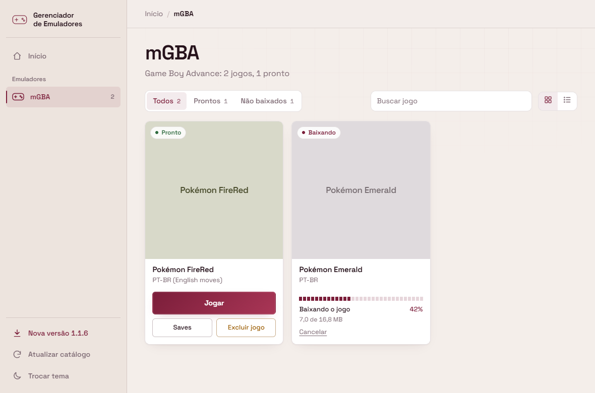
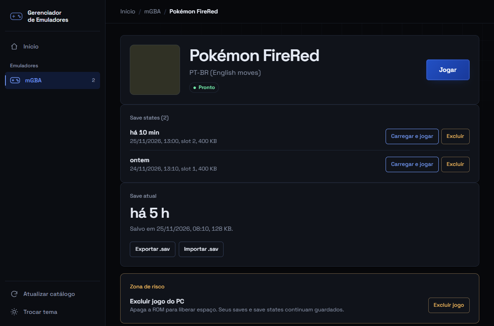

# Gerenciador de Emuladores

Launcher para Windows que organiza seus emuladores e jogos, baixa tudo sob demanda e abre cada jogo no emulador certo.

[**Baixar**](https://github.com/igordssrosa/gerenciador-de-emuladores/releases/latest) · [Instalação](#instalação) · [Atualizar](#atualizar)

## Visão geral

O Gerenciador de Emuladores reúne em uma única janela os emuladores e os jogos de cada um. Nada é baixado até você pedir: com um clique em **Baixar**, o app obtém o emulador e o jogo, e com **Jogar** abre o título no emulador correto, já configurado.

| Recurso                       | Descrição                                                                                           |
| ----------------------------- | --------------------------------------------------------------------------------------------------- |
| **Download sob demanda**      | Emuladores e jogos são baixados quando você pede, com barra de progresso e cancelamento.            |
| **Save states**               | Lista os save states do emulador, do mais recente ao mais antigo, para carregar e jogar ou excluir. |
| **Saves do jogo**             | Importa e exporta o `.sav` de cada jogo.                                                            |
| **Biblioteca**                | Jogos em blocos ou em lista, com capas, filtros (todos, prontos, não baixados) e busca por nome.    |
| **Tema claro e escuro**       | Segue o tema do Windows e pode ser trocado pelo menu lateral.                                       |
| **Uso offline**               | Mantém uma cópia local da lista de jogos e usa o que já foi baixado.                                |
| **Atualização com um clique** | Avisa quando há versão nova e atualiza sem sair do app.                                             |
| **Sem dependências**          | Instalador por usuário, sem privilégios de administrador e sem precisar de Python.                  |

## Instalação

**Requisitos:** Windows 10 ou 11 e conexão com a internet para os downloads.

1. Baixe o `Instalar-GerenciadorEmuladores-X.Y.Z.exe` na página de [Releases](https://github.com/igordssrosa/gerenciador-de-emuladores/releases/latest).
2. Execute o instalador. Ele instala apenas para o seu usuário e não pede senha de administrador.
3. Abra o app pelo atalho da área de trabalho ou do menu Iniciar.

Também há o `GerenciadorEmuladores.exe` avulso, que roda sem instalação.

<b>O Windows exibiu "O Windows protegeu seu PC"</b>

 

O aviso do SmartScreen aparece para programas novos que não possuem assinatura digital. Clique em **Mais informações** e depois em **Executar assim mesmo**. Todo o código-fonte está neste repositório para consulta.

<b>O app pediu para instalar o WebView2</b>

 

A interface usa o Microsoft Edge WebView2, componente gratuito que já acompanha o Windows 11 e a maioria dos Windows 10. Se estiver ausente, o app oferece baixá-lo e instalá-lo na primeira abertura.

<b>Alguma capa ou download não aparece</b>

 

Confira se há conexão com a internet e use **Atualizar catálogo** no menu lateral para baixar a lista de jogos de novo.

## Atualizar

Quando existe uma versão nova, aparece o botão **Nova versão** no menu lateral. Ao clicar e confirmar, o app baixa a atualização, fecha, instala por cima e abre de novo sozinho. Seus jogos, saves e save states não são mexidos.

Se houver um jogo aberto no emulador, o app pede para fechá-lo antes de atualizar. Se preferir, instale a versão nova manualmente: basta rodar o `Instalar-GerenciadorEmuladores-X.Y.Z.exe` por cima do atual.

## Seus dados

Jogos, emuladores, saves e save states ficam em `%LOCALAPPDATA%\GerenciadorEmuladores\`, fora de pastas sincronizadas como o OneDrive, para evitar que um `.sav` seja sincronizado enquanto o emulador escreve nele. Desinstalar o app remove só o programa: seus jogos e saves permanecem nessa pasta e podem ser apagados manualmente.

> [!NOTE]
> Este projeto não inclui nem distribui ROMs ou BIOS. Use apenas conteúdo que você tem direito de utilizar.
